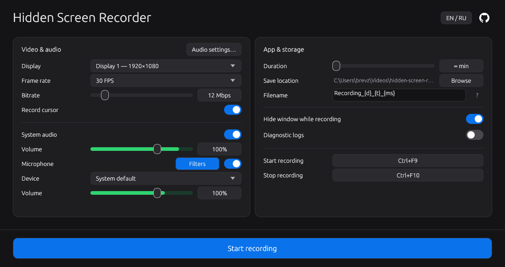

<p align="center"></p>

<h1 align="center">Hidden Screen Recorder</h1>
<p align="center">Record your screen. Capture your audio. Keep it simple.</p>

<p align="center">
  
  
  <a href="LICENSE"></a>
</p>

<p align="center">
  <a href="https://github.com/brevzor/hidden-screen-recorder/releases"></a>
  <a href="https://github.com/brevzor/hidden-screen-recorder"></a>
</p>

<p align="center"><strong>English</strong> · <a href="README.ru.md">Русский</a></p>

<p align="center"></p>

A native Windows screen recorder built with Rust. Saves H.264 / AAC video to MP4 without FFmpeg, Python, or virtual audio drivers.

## Features

- **Screen capture** — select a monitor, frame rate, bitrate, and cursor visibility.
- **Audio** — system sound and a chosen microphone, separate volume controls, 48 kHz stereo. **Audio settings…** offers 100/250/500 ms buffering (250 ms by default) and a device timestamp switch for driver compatibility.
- **Hotkeys** — `Ctrl+F9` to start, `Ctrl+F10` to stop. Both are customizable.
- **Live levels** — green meters show output after microphone noise suppression, threshold and volume gain, before and during recording; red indicates clipping. With both sources off, the MP4 contains a silent AAC track.
- **Microphone threshold** — the compact button beside microphone volume opens a noise gate setting (off by default, −60 to −10 dBFS). A marker on the slider shows the threshold; short hold and smooth transitions avoid abrupt cuts. The gate measures input before gain and leaves system audio unchanged.
- **Noise suppression** — RNNoise is enabled by default, including on the first launch after updating earlier settings. Later user choices are preserved. Speex offers adjustable suppression from 0 to −60 dB (−30 dB by default). Both run locally. Controls are in the microphone filter panel.
- **Hidden window** — optionally hide the window and taskbar icon while recording. Turning this off also allows the window to appear in screen sharing. A red badge on the visible taskbar icon indicates recording.
- **Auto-stop** — set a time limit or record without one.
- **Filenames** — custom templates such as `Game_{d}_{t}`; hover `?` for all variables. Existing recordings are never overwritten.
- **EN / RU** — follows the Windows display language; switch beside the GitHub icon. Your choice is saved. Other system languages default to English.

## Download & run

1. Get `hidden-screen-recorder.exe` from [Releases](https://github.com/brevzor/hidden-screen-recorder/releases).
2. Choose your display, audio sources, and output folder.
3. Press **Start recording**. Stop with `Ctrl+F10` to finalize the MP4.

**Windows 10 / 11 x64.** No Rust installation required for the prebuilt exe. If no binary release is available, build below.

The exe can be renamed before launch. Hiding the window does not hide the process from Task Manager. Capture exclusion requires Windows 10 2004+; GDI is used when the initial Windows Graphics Capture check fails.

## Build

Requires Rust stable, Visual Studio C++ Build Tools, and Windows SDK (`x86_64-pc-windows-msvc`).

```powershell
git clone https://github.com/brevzor/hidden-screen-recorder.git
cd hidden-screen-recorder
cargo build --locked --release
```

Output: `target\release\hidden-screen-recorder.exe`.

## Built with

| Libraries | Purpose |
| :--- | :--- |
| [eframe / egui](https://docs.rs/eframe/0.33) | Native UI and OpenGL rendering |
| [windows-capture](https://docs.rs/windows-capture/2.0.1) | Screen capture and Media Foundation encoding |
| [wasapi](https://docs.rs/wasapi/0.25) | Audio device enumeration and formats |
| [nnnoiseless](https://github.com/jneem/nnnoiseless) | Local RNNoise microphone noise suppression |
| [SpeexDSP 1.2.1](https://github.com/xiph/speexdsp) | Bundled adjustable microphone noise suppression; statically compiled with the existing C++ build tools |
| [windows](https://docs.rs/windows/0.62), [raw-window-handle](https://docs.rs/raw-window-handle/0.6) | Native WASAPI capture, Win32 APIs, and window handles |
| [serde](https://docs.rs/serde/1), [serde_json](https://docs.rs/serde_json/1) | Settings serialization |
| [rfd](https://docs.rs/rfd/0.15), [directories](https://docs.rs/directories/6) | Folder picker and system paths |
| [chrono](https://docs.rs/chrono/0.4), [tempfile](https://docs.rs/tempfile/3) | Timestamps and atomic settings saves |
| [resvg](https://docs.rs/resvg/0.48), [winresource](https://docs.rs/winresource/0.1) | Build-time SVG rendering and Windows icons |

Versions: [Cargo.toml](Cargo.toml) · Locked dependencies: [Cargo.lock](Cargo.lock).

## Settings

Settings: `%APPDATA%\hidden-screen-recorder\config\settings.json`. Legacy settings are imported automatically when the new file is absent.

Logs are off by default. Enable them in the UI to write `hidden-screen-recorder-debug.log` beside the exe. Use the main keyboard for hotkey assignment; NumPad with NumLock on is rejected.

## Development

```powershell
cargo fmt --all -- --check
cargo clippy --locked --all-targets -- -D warnings
cargo test --locked
```

[Report a bug](https://github.com/brevzor/hidden-screen-recorder/issues) · [CI](.github/workflows/ci.yml)

[MIT](LICENSE) © Hidden Screen Recorder contributors.
