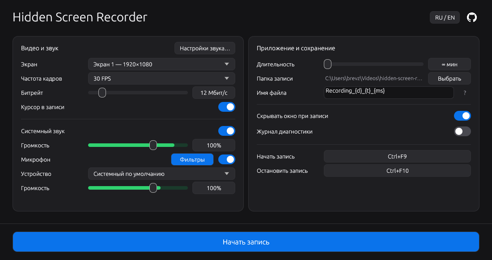

<p align="center"></p>

<h1 align="center">Hidden Screen Recorder</h1>
<p align="center">Запись экрана и звука. Без лишнего.</p>

<p align="center">
  
  
  <a href="LICENSE"></a>
</p>

<p align="center">
  <a href="https://github.com/brevzor/hidden-screen-recorder/releases"></a>
  <a href="https://github.com/brevzor/hidden-screen-recorder"></a>
</p>

<p align="center"><a href="README.md">English</a> · <strong>Русский</strong></p>

<p align="center"></p>

Нативная программа записи экрана для Windows на Rust. Сохраняет видео H.264 и звук AAC в MP4 без FFmpeg, Python и виртуальных аудиодрайверов.

## Возможности

- **Захват экрана** — выбор монитора, FPS, битрейта и отображения курсора.
- **Звук** — системное аудио и выбранный микрофон, отдельная громкость, стерео 48 кГц. В **«Настройки звука…»** — буфер 100/250/500 мс (по умолчанию 250 мс) и переключатель меток времени для совместимости с драйверами.
- **Горячие клавиши** — `Ctrl+F9` для старта, `Ctrl+F10` для остановки. Можно переназначить.
- **Уровни звука** — зелёные индикаторы показывают выходной уровень после шумоподавления, порога микрофона и регулировки громкости до и во время записи; красный означает перегрузку. При отключении обоих источников в MP4 сохраняется дорожка тишины AAC.
- **Порог микрофона** — компактная кнопка рядом с громкостью открывает настройку нижнего порога (по умолчанию выключен, от −60 до −10 dBFS). На ползунке видна отметка порога; небольшая задержка и плавные переходы смягчают обрезание звука. Порог измеряется до усиления и не влияет на системный звук.
- **Шумоподавление** — RNNoise включён по умолчанию, в том числе при первом запуске после обновления старых настроек. Последующие изменения пользователя сохраняются. Дополнительно доступен Speex с настройкой от 0 до −60 дБ (по умолчанию −30 дБ). Обработка выполняется локально; управление — в панели фильтров микрофона.
- **Скрытие окна** — окно и значок на панели задач скрываются на время записи по желанию. Если скрытие выключено, окно также видно при демонстрации экрана. Красная отметка на видимом значке панели задач означает, что идёт запись.
- **Автоостановка** — запись с ограничением длительности или без него.
- **Имена файлов** — шаблоны вроде `Game_{d}_{t}`; все переменные — в подсказке `?`. Существующие записи не перезаписываются.
- **RU / EN** — язык Windows по умолчанию, переключатель слева от GitHub. Выбор сохраняется. Для остальных языков системы используется английский.

## Скачать и запустить

1. Скачайте `hidden-screen-recorder.exe` из [Releases](https://github.com/brevzor/hidden-screen-recorder/releases).
2. Выберите монитор, источники звука и папку сохранения.
3. Нажмите **«Начать запись»**. Завершите через `Ctrl+F10`, чтобы сохранить MP4.

**Windows 10 / 11 x64.** Для готового exe Rust не нужен. Если релиза с бинарным файлом пока нет, соберите приложение ниже.

Exe можно переименовать перед запуском. Скрытие окна не скрывает процесс в Диспетчере задач. Исключение из захвата требует Windows 10 2004+; если начальная проверка Windows Graphics Capture не проходит, используется GDI.

## Сборка

Нужны Rust stable, Visual Studio C++ Build Tools и Windows SDK (`x86_64-pc-windows-msvc`).

```powershell
git clone https://github.com/brevzor/hidden-screen-recorder.git
cd hidden-screen-recorder
cargo build --locked --release
```

Готовый файл: `target\release\hidden-screen-recorder.exe`.

## Библиотеки

| Библиотеки | Назначение |
| :--- | :--- |
| [eframe / egui](https://docs.rs/eframe/0.33) | Нативный интерфейс и отрисовка OpenGL |
| [windows-capture](https://docs.rs/windows-capture/2.0.1) | Захват экрана и кодирование Media Foundation |
| [wasapi](https://docs.rs/wasapi/0.25) | Перечисление аудиоустройств и форматы звука |
| [windows](https://docs.rs/windows/0.62), [raw-window-handle](https://docs.rs/raw-window-handle/0.6) | Нативный захват WASAPI, Win32 API и дескриптор окна |
| [serde](https://docs.rs/serde/1), [serde_json](https://docs.rs/serde_json/1) | Сериализация настроек |
| [rfd](https://docs.rs/rfd/0.15), [directories](https://docs.rs/directories/6) | Выбор папки и системные пути |
| [chrono](https://docs.rs/chrono/0.4), [tempfile](https://docs.rs/tempfile/3) | Временные метки и атомарное сохранение настроек |
| [resvg](https://docs.rs/resvg/0.48), [winresource](https://docs.rs/winresource/0.1) | Преобразование SVG и иконки Windows при сборке |

Версии: [Cargo.toml](Cargo.toml) · Зафиксированные зависимости: [Cargo.lock](Cargo.lock).

## Настройки

Файл: `%APPDATA%\hidden-screen-recorder\config\settings.json`. Настройки старой версии читаются автоматически, если нового файла ещё нет.

Логи по умолчанию выключены. При включении в интерфейсе файл `hidden-screen-recorder-debug.log` создаётся рядом с exe. Для назначения горячих клавиш используйте основной блок клавиатуры; NumPad с включённым NumLock отклоняется.

## Разработка

```powershell
cargo fmt --all -- --check
cargo clippy --locked --all-targets -- -D warnings
cargo test --locked
```

[Сообщить об ошибке](https://github.com/brevzor/hidden-screen-recorder/issues) · [CI](.github/workflows/ci.yml)

[MIT](LICENSE) © Hidden Screen Recorder contributors.
